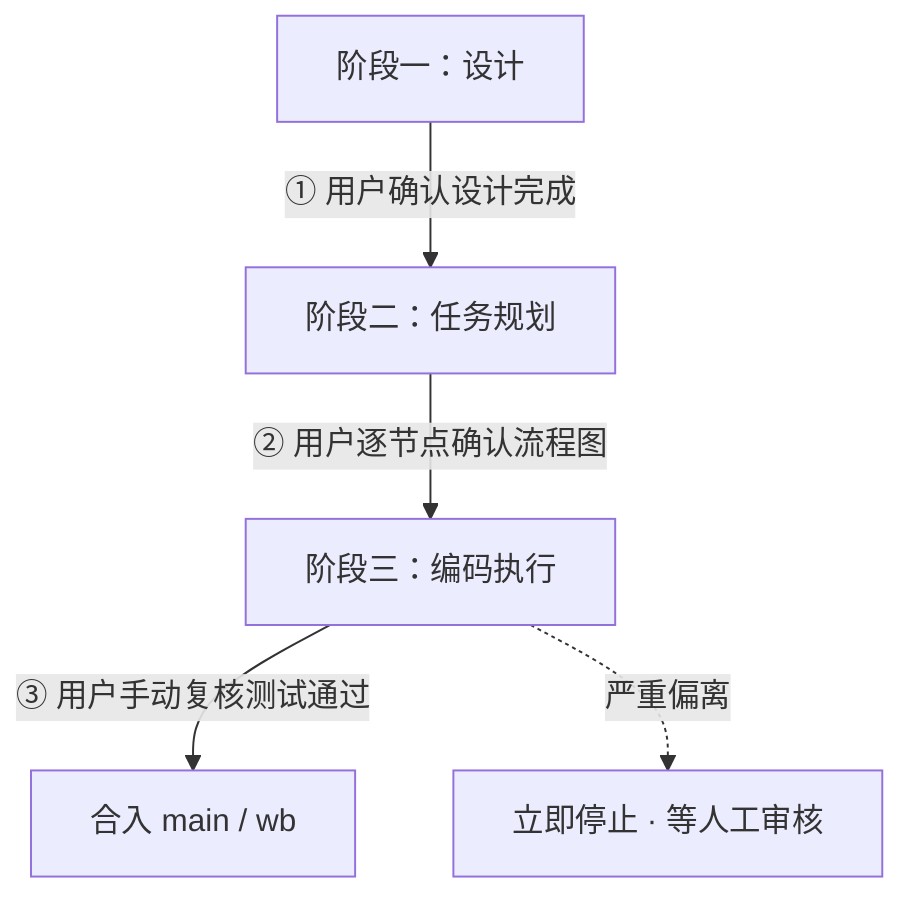

# 智能体驱动开发工作流规范

> **适用范围**：本仓库（t 自托管编译器）由**单一智能体**负责全部编码实现；人类仅承担两项职责——**设计审查**与**人工复核测试**。
>
> **核心思想**：把开发严格划分为「设计 → 任务规划 → 编码执行」三阶段，并以**用户明确确认**作为阶段间与关键节点的强制闸门；把 Git 的 PR 从 code-review 机制，重定义为**人工手动测试的交接单**。本规范固化与之配套的 Git 流程，指导今后所有开发。

---

## 0. 基本原则

1. **分阶段 + 强制确认**：任何阶段不得在未获用户明确确认时自行进入下一阶段；任务规划阶段须**逐节点**确认；编码阶段遇严重偏离必须停。
2. **人类不是 code reviewer**：人类只审设计、只手动测。因此 PR 在本流程中**不是 code-review 机制，而是「人工手动测试的交接单」**。
3. **主干受保护**：`main`（及 `wb`）受保护，智能体**不自行合入**；合入由人工手动测试通过后触发。
4. **智能体的唯一质量门是自验证**：因为没有人类逐行审查，智能体必须以「自举不动点 + gate L2 + 基线同提交」作为每个子任务的**强制完成定义**。

---

## 1. 三阶段总览与确认闸门



| 阶段 | 智能体职责 | 用户职责 | 出口闸门 |
|---|---|---|---|
| 一·设计 | 讨论+编写设计文档；主动审查提优化；不合理处列清单交决策；末尾给示例/测试代码 | 审设计、对清单决策、判断示例是否达成目的 | **① 用户明确确认设计完成** |
| 二·规划 | 生成任务流程图，标注分支/关键判断节点 | 逐节点确认 | **② 用户确认规划可执行** |
| 三·编码 | 按子任务实现+自验证；每子任务审偏离 | 仅在严重偏离/终点介入 | **③ 用户手动测试通过 → 合入** |

> 三个闸门（①②③）缺一不可，且必须由用户**主动、明确**给出确认，智能体不得自行推定「用户应该同意」。

---

## 2. 阶段一：设计

**目标**：在与用户讨论中形成并经用户认可的设计文档。

**智能体行为规范**：

- **主动审查**：对文档中合理之处，直接提出优化修改建议（可一并改入文档草稿，但须标注「建议优化」及理由）。
- **存疑即上交，不擅自处理**：对不合理、存疑、影响面大的点，整理为**清晰标注清单**——每条注明「问题 / 原因 / 影响 / 建议选项」，**交由用户决策**。**严禁智能体自行修改或绕过未决项**。
- **收尾交付物**：设计接近尾声时，生成**示例代码与测试代码**供用户审查，由用户判断其是否达成设计目的；未达成则回到设计修订。

**产出**：`docs/design/<feature>/DESIGN.md`（含决策清单与待决项状态）、示例/测试代码。

**闸门 ①**：用户明确说「设计完成 / 可以进入规划」方可进入阶段二。

---

## 3. 阶段二：任务规划

**触发**：闸门 ① 通过。

**智能体产出**：

- **任务执行步骤流程图**，覆盖全部子任务；
- 在**分支决策点、关键判断节点**用显式标注（如 `⚠ 决策点：A 还是 B？影响…`）；
- 流程图按节点拆分，提交用户**逐节点确认**——确认当前节点后再展开下一节点，**不得一次性求全确认后自行跑完**。

**闸门 ②**：用户确认整图可执行后，方可进入阶段三。

---

## 4. 阶段三：编码执行

**触发**：用户确认「开始编码」。

**执行纪律**：

- 按子任务顺序逐一实现。
- **每完成一个子任务即审查偏离原设计**：
  - 偏离**轻微且具备合理性** → **记录偏离**（写入设计文档「偏离记录」小节）并继续下一子任务；
  - 偏离**严重或缺乏合理性** → **立即停止**，输出偏离说明，等待人工审核，**不得自行推进**。

**每个子任务的完成定义（强制）**：

1. 改完源码；
2. 跑**自举**（`g1 → g2 → g3 → g4` 不动点）通过；
3. **gate L2** 全绿；
4. **IR/TIR 基线重录随源码同提交**（保证分支任一点自洽、可 bisect）；
5. commit（message 讲 why）。

**分支策略**：全部子任务提交到长命 `feat/<feature>` 分支；周期 `merge main` 进分支防终合漂移（每次合并后重跑自举）。

**终点交付**：功能全完后，智能体**不开 code-review 式 PR**，而是开**交付 PR**，内含：

- 设计摘要（含已审决策）；
- **可执行的人工手动测试清单**（步骤 + 预期结果 + 触发方式）；
- 智能体自动验证报告（自举不动点达成、gate L2 全绿、基线 diff 摘要）；
- 偏离记录汇总。

**智能体不自合主干**，停在「等人工手动复核测试」。

**闸门 ③**：用户按清单手动复核测试 → 通过 → 合入 `main`/`wb`（合入由人工测试通过后触发；按现行约定可由智能体在用户明确「通过」后合入 `wb`）。

---

## 5. Git 流程规范（配套）

- **分支模型**：`main`/`wb` 受保护（仅人工测试通过后合入）；开发在长命 `feat/<feature>` 分支，单智能体独占，无并行分支、无 merge queue、无 CODEOWNERS。
- **提交纪律**：原子提交；一子任务一提交；**不 squash**（保留子任务粒度作 bisect 锚点）；message 用祈使句写 what、正文写 why。
- **基线随源码同提交**：IR/TIR 快照基线重录与对应源码改动在**同一 commit**。
- **防漂移**：周期 `merge main` 进 `feat/<feature>`，合并后重跑自举。
- **PR 角色**：人工手动测试移交单，非 code-review；内容见 §4 终点交付。
- **智能体禁区**：不得直推/直合 `main`；`wb` 仅在用户明确「测试通过」后合入。

---

## 6. 行为红线（违反即中止并上报）

1. 未获明确确认，进入下一阶段或跑完规划节点。
2. 对未决/存疑设计点擅自修改或绕过。
3. 编码中发生严重偏离仍自行推进。
4. 跳过自举 / gate / 基线同提交任一即 commit。
5. 未经人工测试通过自行合入主干。

---

## 7. 模板

### 7.1 设计文档 `docs/design/<feature>/DESIGN.md` 骨架

```markdown
# <feature> 设计

## 背景与目标
## 方案概述
## 关键决策（含理由）
## 待决项清单（状态：待用户决策 / 已决）
| 项 | 问题 | 原因 | 影响 | 建议选项 | 状态 |
## 示例与测试代码评审
## 偏离记录（编码阶段追加）
| 子任务 | 偏离描述 | 合理性 | 处置 |
```

### 7.2 交付 PR 模板

```markdown
## 设计摘要
（链接 DESIGN.md，列出已审关键决策）

## 子任务清单与完成情况
## 自动验证报告
- 自举不动点：g2==g3==g4 ✅/❌
- gate L2：✅/❌
- 基线 diff：<摘要>

## 偏离记录
## 人工手动测试清单（请逐项复核）
- [ ] 步骤 / 预期 / 触发方式

## 合入请求
待人工手动测试通过后合入 main / wb
```

---

*本文档为流程规范，覆盖并细化「任务完成后 merge 到 wb」「人类仅审设计+手动测」的既有约定；具体编译/门禁技术细节以 `docs/compiler/` 与 `.workbuddy/memory/MEMORY.md` 为准。*
