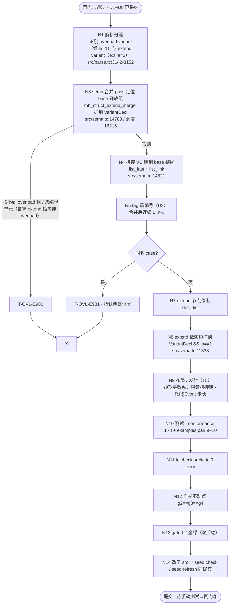

# 开放变体（open variant）设计

> 状态：**闸门①已通过 —— D1~D8 全部采纳（2026-10-18）｜ 现处阶段二·任务规划（逐节点确认，待闸门②）**
> 阶段：阶段一·设计草稿 → 阶段二·任务流程图 ｜ 日期：2026-10-18
> 参照实现：`docs/design/struct-modifiers/DESIGN.md`（struct 开放维度，已落地）
> 上游文档：`docs/syntax/drafts/adt_variant.md`（抽象变体 `_` 裁定）、`docs/struct-modifiers.md`

---

## 1. 背景与目标

### 1.1 需求一句话

让 `variant` 像 `struct` 一样具备**开放维度**：在一个编译单元内，允许把构造器（case）分散声明，后续声明向既有 variant **追加**构造器。

### 1.2 动机

当前要扩展一个代数数据类型，只能回头改原声明：

```t
variant Event { Key(i64); Click(i64, i64); }      // 原文件
// 新模块想加 Wheel(i64)？要么改这个文件，要么另建一个 variant。
```

这与「可组合的程序结构」矛盾——尤其当一个通用库类型（事件、语法节点、AST 节点）希望被使用方按自己的域追加分支时。

struct 侧已经解决了同样的问题（`overload struct` 声明开放组 + `extend struct` 追加，按 §3.0 公理裸 `extend`；历史上曾写作 `extend overload struct`，已于 2026-10-18 迁移为裸 `extend`），本设计把同一套开放维度搬到 variant 上，variant 侧直接采用裸 `extend`。

### 1.3 一句话方案

```
库侧：  overload variant Event { Key(i64); Click(i64, i64); }   // 声明为「开放组」
使用方：extend variant Event { Wheel(i64); }                  // 追加构造器（裸 extend；overload 只出现在声明）
```

**追加之后，`Event` 的 case 全集 = 组声明 ∪ 所有 extend 追加**，且类型仍是同一个 `%Event` / `Event` —— 不是子类型、不是新类型。

---

## 2. 先说清楚：variant 的「开放」和 struct 的「开放」有一处致命不同

这是本次设计最重要的一条发现，先摆在前面。

| | struct | variant |
|---|---|---|
| 开放标记 | `overload struct S { ... _; }` —— **尾部 `_` 是扩展锚点** | **`_` 已被占用**：variant 末位 `_` = **抽象标记**（豁免 match 穷尽性，`docs/syntax/drafts/adt_variant.md:190` 已裁定） |
| `_` 是否生成实体 | 否（纯占位，`examples/struct_extend_a.tc:24` 明确「不占空间」） | 否（语义标记） |
| `_` 的语义 | 「这里预留给扩展」 | 「这个和类型是非穷尽的／抽象的」 |

两者字面上是同一个 token，语义完全不同。如果照抄 struct 的锚点写法，会立刻产生二义性：

```t
overload variant E { Key(i64); _; }   // 这个 `_` 是扩展锚点，还是「E 是抽象变体」？
```

**裁定（本设计采用）：variant 的开放不依赖 `_`，也不需要锚点。**

- `overload variant V { ... }` 本身就是开放组标记；
- extend 的 case **追加在 case 链尾部**即可，无需锚点定位；
- `_` 保持其原有且**唯一**的语义：抽象／非穷尽。

由此两条凑正交：

| 有没有 `overload` | 有没有 `_` | 结果 |
|---|---|---|
| ✅ | ❌ | **开放且封闭**：可追加构造器，且 match 仍强制穷尽（见 §3.4） |
| ❌ | ✅ | 闭变体但抽象：不可追加，match 免穷尽（现状，`T-MAT-E742` 豁免） |
| ✅ | ✅ | 开放且抽象：可追加，match 免穷尽 |
| ❌ | ❌ | 普通常闭变体（现状） |

> 这条也是把 struct 的锚点写法**不**照搬进 variant 的唯一理由，需要在评审时确认。

### 2.1 「那 struct 尾部那个 `_` 算什么？」——**它曾经不算任何东西，现已拆除**

> **2026-10-18 更新**：评审提出该问题后经核实，该写法是零痕迹的空操作；用户裁决
> 「不做兼容策略、无迁移窗口」（当前无外部用户）⇒ **直接删除语法分支，不加废弃警告**。
> 本节保留核实链作为决策依据，现状以「已拆除」为准。

证据一：parser 直接吞掉、`_` 不产生任何节点（`src/parse.tc:5342-5347`）

```t
} else if (lex.cur_t() == "Identifier" and lex.cur_v() == "_" and lex.peek_t(1) == "Semicolon") {
    lex.advance_i();                                     // 吃掉 `_`
    if (lex.cur_t() == "Semicolon") { lex.advance_i(); } // 吃掉 `;`
}   // ← 没有 node_new、没有 node_set_*：AST 里不留任何东西
```

证据二：注释宣称的「extend 追加字段接在其后」与锚点**无因果关系**。
实际合并是 `list_last(base_head)` 取链尾 + `list_link(bt, ext_head)` 接在尾部
（`src/sema.tc:14821-14830`）—— 与是否存在锚点节点无关（该节点根本不存在）。

证据三：packed 位域的 `_:u2` 才是「真占位」（实占 2 bit、参与布局，
`examples/struct_modifiers.tc:20`），与 struct 扩展锚点也不是一回事。

#### `_` 的完整户口表（现行实现）

| 位置 | 写法 | 语义 | AST 痕迹 |
|---|---|---|---|
| packed 结构体成员 | `_:u2;` | 未命名占位字段，**实占位宽** | ✅ 真字段，参与布局 |
| match 臂 | `_ => ...` | catchall 通配 | ✅ `pwild` 标记 |
| 形参 | `_ : T` / 裸 `_` | 忽略该形参 | ✅ `src/parse.tc:2056` |
| **variant 声明末位** | `_;` | **抽象 / 非穷尽** | ✅ `node_set_ba(true)`（`src/parse.tc:5493`） |
| **overload struct 尾部** | `_;` | 扩展锚点 | ❌ **零痕迹（本表唯一）** → 已于 2026-10-18 **拆除**，写了即语法错误 |

用法分布（曾严重失衡）：
- struct 扩展锚点：曾全仓 3 处（`examples/struct_extend_a.tc`、`examples/struct_modifiers_extend.tc`、
  `tests/conformance/pass/p_struct_overload_extend_ok.tc`）—— 三处去掉该行后行为逐字节不变
- variant 抽象标记：**3 个 conformance 用例**在守（`p50`、`f136`、`f139`）

#### 这件事反过来加强了 D7

struct 的开放性由 `overload` 关键字独占即可表达；那个 `_` 从来没承担过任何真职责。
variant 没有理由继承一个被证明为空操作的写法 —— 这是 §2 / D7 立场的第二个支柱。

#### D8 的落地结果（2026-10-18，用户裁决「无兼容策略」）

改动清单：
- `src/parse.tc`：删除成员循环的 `_` 锚点分支（吞掉 `_;` 的那一段）；`overload struct` 桥处的
  注释由「编译器合成尾部 `_` 扩展锚点」更正为「开放性由 `overload` 独占表达」
- `examples/struct_extend_a.tc`、`examples/struct_modifiers_extend.tc`、
  `tests/conformance/pass/p_struct_overload_extend_ok.tc`：去掉 `_;` 并更新注释
- `examples/cross/struct_extend_b.tc`：注释「排在 `_` 之后」→「排在字段链尾部」
- `docs/design/struct-modifiers/{DESIGN.md,EXAMPLES_extend_a.tc}`：更正 §2.1 描述与 EBNF 口径

结果：StructDecl 与 VariantDecl 的开放性**统一由 `overload` 表达**；类型声明体里的 `_;`
只剩一种含义 —— **variant 的抽象 / 非穷尽标记**。开放变体因此不需要、也不会引入锚点。

---

## 3.0 公理：`extend` ⊑ `overload`（2026-10-18 裁定）

> **公理**：`extend` 的语义必然是「向一个已存在的、`overload` 声明的可合并开放组追加」。`extend` 无法脱离 overload 独立成立——`extend` 一个非 overload 的东西在语义上不成立（那不是 extension，是别的词）。
> 因此 **`extend` 子句中的 `overload` 标记是纯冗余**：解析器／sema 靠名字查「这是否为 overload 组」即可，词面不必再标一次。任何语言（不限于 t）都应裸写 `extend`。

规范语法（fn / struct / variant **三者统一**）：

```
overload <kind> Name { … }     // 声明开放组（opt-in，overload 只在此出现一次）
extend   <kind> Name { … }     // 追加，裸 extend，无需 overload
```

- **variant 侧**：本次直接采用裸 `extend variant` 规范（见 §3.1、§5）。
- **fn / struct 侧**：历史上曾写作 `extend overload fn` / `extend overload struct`，属**违背本公理的冗余写法，已于 2026-10-18 迁移为裸 `extend`**（"no exception"）。
  - 迁移列为本 epic 的**跟随清理**（§5 节点 N0）；它触及已发布语法（fn/struct 的 extend 子句），需用户显式授权后再执行，不悄悄塞进 variant 编码。

---

## 3. 方案设计

### 3.1 语法（EBNF）

```
VariantDecl      := 'variant' Ident '{' CaseList '}'                      // 现状：普通常闭
OpenVariantDecl  := 'overload' 'variant' Ident '{' CaseList '}'           // 新增：开放组（A 侧）
ExtendVariant    := 'extend' 'variant' Ident '{' CaseList '}'            // 新增：追加（B 侧，裸 extend，见 §3.0 公理）
CaseList         := ( VariantCase ';' )+
VariantCase      := Ident [ '(' Type (',' Type)* ')' ] | '_'
// `_` 只能出现在末位（现状规则：T-PAR-E103）
```

约束（对齐 struct 开放维度，并遵循 §3.0 公理）：

0. **`extend` 子句裸写（公理）** —— `overload` 仅出现在「声明开放组」处；`extend variant` 不再写 `overload`（历史 `extend overload struct/fn` 已于 2026-10-18 迁移为裸 `extend`，见 §3.0）。
1. **被扩展者必须已用 `overload` 声明** —— 否则找不到组，报 `T-OVL-E980`（与 struct 走同一条诊断，语义「无匹配的开放组」）；注意「裸 `extend` 指向非 overload」同样在 sema 期以 E980 捕获，**不再有解析期语法错**。
2. **必须同一编译单元** —— 与上条同源，跨编译单元即 E980。
3. **extend 段不可为空**、不可出现在 `overload` 组声明之前（顺序无关：**见 D3**，推荐不强制顺序，因为合并 pass 在 sema 期做，线序无意义）。

### 3.2 语义：case 链拼接

- AST 层：`VariantDecl` 的构造器是挂在 `node_lb` 上的 **`VC` 子节点链表**（每个 case 一个 `VC`，`src/parse.tc:5418` `parse_case`），与 struct 的字段链表同构 ⇒ **拼接逻辑可直接复用**。
- 合并动作：把 extend 段的 `VC` 链**接到被扩展组的 `VC` 链尾部**（`list_last` + `list_link`，与 `src/sema.tc:14821-14830` 逐字同构）。
- **tag 分配**：`VC.ia` 在合并**之后**按最终顺序重新编号（0 起）。
  - ⚠ 这是个决策点：**重编号 vs 保号**。见 D2。推荐「保持各段内原有相对顺序，按合并后的最终顺序连续重编号」——因为 tag 是本编译单元内部的布局细节，不跨二进制 ABI，重编号可保证 tag ∈ [0, n) 紧凑，且 union size 不会因序号空洞变大。
- 合并完成后，把 extend 声明节点从 `decl_list` 移除（照搬 struct 做法），避免二次类型注册／重名误报。

### 3.3 合并发生在哪一阶段（为什么布点在这里）

对齐 struct：`run_check()` 内 **`resolve_modules()` 之后、`mangle_modules()` 之前**（现状 struct 合并 `mb_struct_extend_merge` 在 `src/sema.tc:16216`）。

这个位置的三重好处：

1. `resolve_modules()` 已把 `@import` 的模块内联进同一 `decl_list` ⇒ **跨文件 extend 天然可见**；
2. 早于 type 注册（`register_variant_helpers`，`src/sema.tc:2972`）与重整 ⇒ helper（`V_from_C` / `V_is_C` / `V_as_C`）按**合并后的全集**一次性合成，不会重复也不会漏；
3. **早于所有布局计算与发射** ⇒ `tir_variant_mx`（`src/tir.tc:1607`）、`emit_variant_decl`（`src/codegen_c.tc:4429`）都只读同一条已拼接的 case 链，**布局自动正确，零改动**。

### 3.4 穷尽性检查：开放 ≠ 免穷尽（本设计的立场）

因为合并在 sema 早期完成，进入 match 检查时 case 全集已经确定，所以：

> **开放变体仍然强制 match 穷尽性**（`T-MAT-E742` 照旧生效）。

这与「抽象变体 `_`」形成清晰分工：

- `overload` —— 管**能不能**追加构造器；
- `_` —— 管 match **要不要**列全。

想要「开放且免穷尽」，两者都写；只想要前者，只写 `overload`。这是本设计相对 struct 版的一个语义增强，也保留了未来「真的跨二进制开放」时再引入豁免的余地。

### 3.5 重复构造器名

现状**没有**重名检查：`sym_define` 遇到同名非 var 符号静默 return（`src/sema.tc:1206-1211`）。普通 variant 重名是本地错误、影响有限；但一旦开放，「两处各自声明了同一个 case」会成为常态风险，且**静默失效**是最坏结果。

⇒ 新增诊断 **`T-OVL-E981`** `variant extend 重复构造器`：同一 variant（按合并后全集）出现同名 case 即报错，并指认两处位置。

### 3.6 不做的事（明确边界）

| 能力 | 是否纳入 | 理由 |
|---|---|---|
| 追加构造器 | ✅ | 本次核心 |
| **覆盖／重载已有 case 的载荷** | ❌ | 见 D1 —— 会改变已合成 helper 签名、打破既有调用点，且项目无「重载 = 改写签名」先例 |
| variant 构造器进 `TypeInfo` 反射 | ❌ | 当前 `TypeInfo` 连 variant 专属 arm 都没有（variant 被映射为 `Union`），属独立议题 |
| `@derive` 支持 variant | ❌ | `derive_gen.tc` 仅认 Struct/Union，独立议题 |
| 修 C 侧 `uint32_t` vs LLVM 侧 `i64` 的 tag 宽度不一致 | ❌ | 既有事实，不跨 ABI 时无害；记录进 `docs/compiler/known-issues.md`，不在本 epic 触碰 |

### 3.7 「谁消费它」（项目红线自查）

项目红线：只定义不被调用的能力 = 死代码，明确禁止（`docs/compiler/metafunction.md:301`）。逐项自答：

| 新增物 | 消费者 |
|---|---|
| `overload variant` 组标记（`ia=1`） | extend 合并 pass 的 base 查找 + `emit_deps` 的 extend 边输出 |
| `extend variant`（`ia=2`） | 同上（作为 ext 项） |
| `T-OVL-E981` | sema 合并 pass 的重名检查（必然触发于重复 case） |
| `emit_deps` extend 边扩到 `VariantDecl` | tote 增量构建（“被扩展单元 + 扩展闭包”拼同一编译单元） |

> 顺带：调研发现 **`T-PAR-E104` 已登记但全仓无 emit 点**（`tools/diag_defs.json:141` + `src/diag_table.gen.h:123` + `src/base.tc:4125`），是该红线的一个**现存反例**。建议在本 epic 附带处置：要么接线，要么显式标注待清理（需你裁决，见 D6）。

---

## 4. 关键决策清单（★ 已全部采纳，2026-10-18）

| 编号 | 决策点 | 选项 | 建议 | 理由 |
|---|---|---|---|---|
| **D1** | 开放的含义 | A. 仅追加构造器（append-only）<br>B. 追加 + 可覆盖已有 case 载荷 | **A** ✅已采纳 | B 会让 `<V>_as_<C>` 等 helper 签名漂移、既有调用点 ABI 破裂，且无语义先例可循；A 与 struct 开放维度完全同构 |
| **D2** | 追加后 tag 如何编号 | A. 合并后连续重编号（0..n-1）<br>B. 各段保留原号，允许空洞 | **A** ✅已采纳 | tag 是编译单元内部布局细节，不跨 ABI；重编号保证紧凑，union size 不因空洞膨胀 |
| **D3** | 是否要求先出现开放组声明 | A. 不要求（sema 期合并，线序无关）<br>B. 要求 `overload` 组在前 | **A** ✅已采纳 | 合并是 sema pass，与源码顺序无关；强制顺序只会徒增约束 |
| **D4** | 是否必须 `overload` opt-in | A. 必须（无 `overload` 不可 extend）<br>B. 任意 variant 均可被 extend | **A** ✅已采纳 | 保持「一处声明 = 全集起点」的可读性；也让遗漏 `extend` 意图成为显式错误而非静默追加；**extend 子句按 §3.0 公理裸写，无 `overload`** |
| **D5** | 开放变体的 match 穷尽性 | A. 仍强制（须显式 `_` 才豁免）<br>B. 开放即自动豁免 | **A** ✅已采纳 | 合并后全集已定，强制检查免费且更安全；`_` 语义保持单一 |
| **D6** | `T-PAR-E104`（多载荷方位 Gag，无 emit 点） | A. 本 epic 顺手接线<br>B. 显式标注待清理、不动<br>C. 现在就删 | **B** ✅已采纳（标注待清理、不动） | 与本特性无关，但属「登记即死」；删除需确认历史上是否留给外部文档引用 |
| **D7** | `_` 锚点写法是否要对齐 struct | A. variant **不用**锚点（本设计立场）<br>B. 引入 `overload variant V { A; _; }` 锚点 | **A** ✅已采纳 | 见 §2 —— variant 的 `_` 已是抽象标记，复用必然二义；且 §2.1 证明 struct 锚点是零痕迹空操作，没有继承价值 |
| **D8** ✅已决 | struct 那个**零痕迹锚点**如何处置（§2.1 发现） | A. 删除该语法分支<br>B. 保留 + 废弃警告、下 epic 删<br>C. 仅文档标注无效 | **A** ✅已决（2026-10-18 已执行） | 用户裁定「没有兼容策略、当前没有用户」⇒ 废弃警告的迁移窗口无意义，直接删。已执行 —— 改动清单见 §2.1「D8 的落地结果」 |

---

## 5. 阶段二 · 任务流程图（逐节点确认，待闸门②）

> 闸门①已通过（D1~D8 全部采纳，2026-10-18）。本阶段把 T1~T7 细化为**逐节点流程图**，
> 分支 / 关键判断节点已显式标注。请逐节点确认（重点：**N3 / N6** 两个判断节点；N2 语法校验已按 §3.0 公理撤销），
> 任一处需调整告诉我；确认全过后，再进阶段三编码。

### 5.1 整体流程图



### 5.2 逐节点清单（动作 / 落点 / 关键判断 / 验收判据）

| 节点 | 动作 | 落点（现状位置） | 关键判断 / 分支 | 验收判据 |
|---|---|---|---|---|
| **N0** ✅ | **跟随清理（2026-10-18 已授权并落地）**：fn/struct 的 `extend overload <kind>` 迁移为裸 `extend <kind>`（§3.0 公理，no exception） | `src/parse.tc` extend 桥；`examples/overload_*`、`struct_extend_*`、`tests/conformance/**` | 已授权执行；裸 extend 已落地，全仓 `extend overload` 出现处归零（仅设计文档保留历史描述） | 全仓 `extend overload` 出现处归零 |
| **N1** | 解析分流：识别 `overload variant`（组，ia=1）与 `extend variant`（ext，ia=2），产出 `VariantDecl` | `src/parse.tc:3142-3152` variant 桥；参照 `2899-2927` struct extend 桥 | 与 struct 桥同构，新增 variant 分支；`extend` 裸写（无 `overload` 子句） | 单测：两种声明都能 parse 出正确的 ia |
| **N3** | sema 合并 pass：定位 base 开放组 | `src/sema.tc:14783` `mb_struct_extend_merge`，调度 `16216` | 分支：**找不到 `overload` 组 / 跨编译单元 → `T-OVL-E980`**（约束 2/3） | 对应 `f_variant_extend_no_group` |
| **N4** | 拼接 VC 链到 base 链尾 | `src/sema.tc:14821` `list_last + list_link` | 复用 struct 拼核；`StructDecl` 判定扩为 `StructDecl \| VariantDecl` | 合并后 case 全集 = 组 ∪ ext |
| **N5** | tag 重编号（D2） | 合并后新代码 | **连续重编号 0..n-1**（非保号） | union size 紧凑、无空洞 |
| **N6** | 重名检查（D1 边界） | 合并 pass 内 | 分支：**同 variant 同名 case → `T-OVL-E981`，指认两处** | 对应 `f_variant_extend_dup_case` |
| **N7** | extend 节点移出 `decl_list` | sema | 避免重复类型注册 / 重名误报（照搬 struct） | 单组只注册一次 helper |
| **N8** | extend 依赖边扩展 | `src/sema.tc:11533` | 条件 `StructDecl && ia==1` → 含 `VariantDecl && ia==1` | tote 增量构建闭包正确 |
| **N9** | 布局 / 发射（T5） | `src/tir.tc:1607`、`src/codegen_c.tc:4429` | **预期零改动**；风险 R1：`[]Event` 切片步长 | IR 快照：既有条目零漂移 |
| **N10** | 测试 | `tests/conformance/**`、`examples/**` | 见 §7 清单 1~10 | pass 1~8 + 双后端 golden 9~10 |
| **N11** | 类型检查 | — | — | `tc check src/tc.tc` 0 error |
| **N12** | 自举不动点 | — | — | `g2 == g3 == g4`（IR md5 一致） |
| **N13** | 门禁 L2 | — | — | `gate L2` 全绿（含 IR 快照 / conformance / run_examples 双后端） |
| **N14** | 种子同步 | `ci/seed/tc.exe` | 改了 src ⇒ 必跑 | `npm run seed:check`（必要时 `seed:refresh`，与代码同提交） |

---

## 6. 示例（供判断「这是否达成目的」）

### 6.1 单文件：开放组 + 同文件 extend

参见 `EXAMPLES.tc`：

```t
// 库侧：声明为开放组
overload variant Event { Key(i64); Click(i64, i64); }

// 使用方：追加构造器（同一文件或另一文件均可，裸 extend）
extend variant Event { Wheel(i64); }

fn to_str(e: Event) string {
    return match (e) {
        .Key(k)     => "key=" + int_to_str(k)
        .Click(x,y) => "click"
        .Wheel(d)   => "wheel=" + int_to_str(d)   // 来自 extend
    };
}
```

注意这里的**传播路径**：`Wheel` 从未出现在组声明里，但 `match` 必须列出它（`D5` 立场下，漏列即 `T-MAT-E742`）。

### 6.2 跨文件 pair

- `EXAMPLES_extend_a.tc`：含 `overload variant` 组 + `@main`（放 `examples/` 顶层以获得 ir_snapshot 覆盖）
- `EXAMPLES_extend_b.tc`：仅 extend 片段（放 `examples/cross/`，躲开单文件扫描）
- 合并编译：`tc run examples/open_variant_a.tc examples/cross/open_variant_b.tc`

照搬 struct 侧 `struct_extend_a.tc` / `cross/struct_extend_b.tc` 的既定惯例（该项目 memory：「跨文件 pair 落点惯例」）。

---

## 7. 测试清单（阶段三验收）

**conformance · pass**

1. `p_variant_overload_extend_ok` —— 同文件追加单元 case + 载荷 case，构造 + match + 正确值
2. `p_variant_overload_extend_multi_payload` —— 追加多载荷 case（`Wheel(i64, bool)`）
3. `p_variant_overload_cross_unit_match` —— 追加后的 case 参与穷尽 match
4. `p_variant_overload_still_exhaustive` —— 追加后漏列 case ⇒ 仍应报错（fail 侧验证更有力，见下）

**conformance · fail**

5. `f_variant_extend_no_group` —— extend 到一个从未 `overload` 的普通 variant ⇒ `T-OVL-E980`
6. `f_variant_extend_dup_case` —— 两处声明同名 case ⇒ `T-OVL-E981`
7. `f_variant_extend_missing_case_match` —— 追加后 match 未列新 case ⇒ `T-MAT-E742`（验证 §3.4 立场）
8. ~~`f_variant_extend_syntax`（裸 `extend variant` 解析错）~~ **已撤销**：§3.0 公理下 `extend` 永远语法合法，缺失 overload 组改由 #5 的 `T-OVL-E980` 在 sema 期捕获，无解析期语法错。

**运行级**

9. `examples/open_variant_a.tc` + `examples/cross/open_variant_b.tc` —— 跨文件 pair，带 `.expected.txt`，双后端 golden
10. IR 快照：新示例进 `tools/ir_snapshot.mjs` 目标集 ⇒ 双后端 IR 出现**新增条目**，但**既有条目不得漂移**

**全链路（每子任务完成定义，强制）**

11. `tc check src/tc.tc` 0 error
12. 自举不动点 `g2 == g3 == g4`
13. `gate L2` 全绿（含 IR 快照 / conformance / run_examples 双后端）
14. 改了 src ⇒ `npm run seed:check`（必要时 `seed:refresh`，种子与代码同提交）——**据此纪律，面向 main 的 PR 之前必须完成**

---

## 8. 风险与已识别难点

| 风险 | 说明 | 缓解 |
|---|---|---|
| R1 `mx` 计算时序 | `tir_variant_mx`（`src/tir.tc:1607`）依赖 `g_vf_keys/g_vf_nodes` 在 lower 开头快照；跨文件追加意味着另一文件的 `VC` 也要进这些表 | 合并在 sema 早期完成 ⇒ 进入 TIR 时 case 链已完整，理论上时序不受影响；但**必须在 T5 用 IR 快照 + 运行时 pair 实证**，尤其 `[]Event` 切片步长（踩坑记录见 `src/tir.tc:1766-1767`） |
| R2 双后端 tag 宽度不一致 | C 侧 `uint32_t`（`src/codegen_c.tc:4440`），LLVM 侧 `i64`（`src/tir.tc:1843`） | 既有事实，本 epic 不触碰；若未来要 `@repr(u8)` 收窄，两侧必须同步 |
| R3 `_` 二义性 | 见 §2 | 通过 D7 裁定（variant 不引入锚点）从根上规避 |
| R4 helper 合成的一次性 | `register_variant_helpers`（`src/sema.tc:2972`）为每个 case 合成 `V_from_C` / `V_is_C` / `V_as_C` | 靠「extend 节点合并后移出 `decl_list`」保证只注册一次（照搬 struct） |
| R5 文档陈旧 | `docs/syntax/drafts/adt_variant.md`、`docs/compiler/cst-design-v2.md` 多处引用已不存在的 `src/codegen_ll.tc`（实为 `src/tir_to_ll.tc`） | 本 epic 涉及的文件顺手更正 |

---

## 9. 偏离记录（编码阶段追加）

| 子任务 | 偏离描述 | 合理性 | 处置 |
|---|---|---|---|

---

## 附：关键代码位置速查

```
variant 关键字    lib/std/rc/cst.tc:37-38,55  （overload/extend 为 tier="mod" 上下文关键词）
variant 桥        src/parse.tc:3142-3152
parse_variant_decl src/parse.tc:5462      parse_case src/parse.tc:5418
sema 类型注册     src/sema.tc:2845-2848
构造器 helper     src/sema.tc:2972  (from 3013 / is 3029 / as 3051)
C 布局发射        src/codegen_c.tc:4429  (tag 类型 uint32_t: 4440)
TIR 布局         src/tir.tc:1607 tir_variant_mx / 1843 %V body / 1768-1777 预注册
LLVM 适配        src/tir_to_ll.tc:768 ll_is_variant / 3466
conpat 检查      src/sema.tc:3708 (arity 3736-3751) / 穷尽断言 7582
struct 合并参考  src/sema.tc:14783 mb_struct_extend_merge，调度 src/sema.tc:16216
extend 依赖边    src/sema.tc:11495 / 11533
诊断登记表       tools/diag_defs.json  → src/diag_table.gen.h（由 tools/gen_diag.mjs 生成）
```
